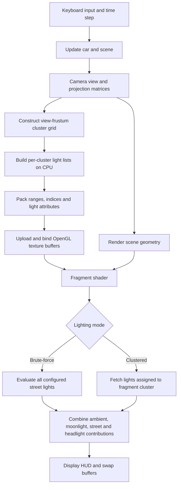

# Night Drive — Technical Implementation Report (Draft)

**Task date:** November 18, 2026
**Project:** Night Drive — Computer Graphics Fundamentals, Topic 7
**Author / responsible engineer:** Tamirlan
**Role:** Integration, HUD & Submission Engineer
**Status:** Technical draft for team review; screenshots and final acceptance evidence still to be attached.

## 1. Objective and Scope

Night Drive is a C++14 / OpenGL 3.3 Core application that renders an interactive low-poly night-driving scene. Its central graphics feature is the comparison of conventional brute-force point-light evaluation against a clustered forward lighting path. The technical documentation describes how the implemented modules connect, explains the essential formulas, and records observed performance. It does not claim that the clustered approach is faster unless the measurements demonstrate that result.

This report is based on the repository source code and the team's manually observed test results. It is a draft, not a certification of every final acceptance criterion.

## 2. Implementation and Build Components

| Component | Main file(s) | Responsibility |
|---|---|---|
| Application entry point | `nightdrive/src/main.cpp` | OpenGL/GLUT initialization, render loop, input and lighting-mode selection |
| Vehicle and scene | `nightdrive/src/car.cpp`, `scene.cpp` | Car updates, low-poly road/city and light placements |
| Cluster construction | `nightdrive/src/clustered_lighting.cpp` | View-frustum clustering, cluster bounds and light-list construction |
| GPU data packing | `nightdrive/src/cluster_gpu_packing.cpp` | Converts per-cluster ranges, light indices and point-light attributes into GPU-ready arrays |
| GPU texture buffers | `nightdrive/src/cluster_gpu_buffers.cpp` | OpenGL buffer/texture creation, per-frame upload and texture-unit binding |
| Shading | `nightdrive/shaders/scene.vert`, `scene.frag` | Transformations and per-fragment lighting using brute-force or clustered paths |
| HUD | `nightdrive/src/nightdrive_hud.cpp` | Displays FPS, speed, status and lighting mode |
| Build | `nightdrive/CMakeLists.txt` | C++14 target, OpenGL/GLEW/GLUT linkage and shader-directory copying |

The build uses OpenGL, GLEW and GLUT/FreeGLUT. `CMakeLists.txt` copies the `shaders` directory next to the built executable. This helps the program load its GLSL files at runtime.

## 3. Rendering Pipeline



**How the code works:** `main.cpp` prepares the camera, builds cluster light lists, packs and uploads their data, binds the GPU texture buffers and passes lighting uniforms to the shader. The fragment shader then takes either the conventional street-light loop or the cluster-index lookup path. The camera, vehicle, road, buildings and HUD are drawn as parts of the same forward-rendered frame.

**Implementation note:** The current initialization in `main.cpp` configures `tilesX = 16`, `tilesY = 9` and `depthSlices = 24`, yielding **3,456 clusters**. The older planning calendar mentions a depth of 8; this document uses the value present in the inspected source code. Update this number if the final merged code changes.

## 4. Clustered Lighting Algorithm

### 4.1 View-frustum subdivision

The camera frustum is divided into a 3D grid with horizontal tiles, vertical tiles and logarithmically spaced depth slices. For the inspected configuration:

- Horizontal subdivisions: **16**
- Vertical subdivisions: **9**
- Depth slices: **24**
- Total clusters: **16 × 9 × 24 = 3,456**
- Near / far planes: **0.1 / 1,000** scene units
- Vertical field of view: **60°**

For slice boundary *i*, the implemented logarithmic depth division is:

```text
z(i) = zNear × (zFar / zNear)^(i / depthSlices)
```

The cluster's linear index is:

```text
index = x + y × tilesX + z × (tilesX × tilesY)
```

A fragment's screen coordinates select its horizontal and vertical tile; its view-space depth selects the depth slice.

### 4.2 Assigning lights to clusters

The CPU constructs cluster bounding boxes and tests which point-light influence spheres intersect them. The sphere–axis-aligned-bounding-box intersection test is implemented in `clustered_lighting.cpp`. Each cluster stores an offset and count that identify a range inside the packed list of light indices. This allows the fragment shader to evaluate only lights assigned to its cluster when the clustered path is selected.

### 4.3 GPU data layout

`ClusterGpuBuffers` creates and updates three OpenGL texture-buffer-backed resources:

| Resource | Internal format | Contents |
|---|---|---|
| Cluster ranges | `GL_RG32UI` | Offset and count for each cluster |
| Light indices | `GL_R32UI` | Indices of relevant lights |
| Packed lights | `GL_RGBA32F` | Position/radius and color/intensity, in packed `vec4` records |

The fragment shader accesses these through `uClusterRanges`, `uClusterIndices` and `uClusterLights`. `main.cpp` binds buffers and updates related uniforms, including `uUseClustered`, near/far values, screen size and grid dimensions. The code supports light presets of **16, 32 and 64** selected with keys `1`, `2` and `3`; `L` toggles between displayed lighting modes.

### 4.4 Light calculation

For a point light at distance *d* with influence radius *r*, the shader includes a squared distance falloff:

```text
attenuation = max(0, 1 - d / r)^2, for d < r
attenuation = 0, for d >= r
```

The surface shading combines a diffuse term and a Blinn–Phong specular term:

```text
L = normalize(lightPosition - surfacePosition)
V = normalize(cameraPosition - surfacePosition)
H = normalize(L + V)
diffuse  = max(dot(N, L), 0)
specular = specCoefficient × max(dot(N, H), 0)^shininess
pointContribution = lightColor × intensity × (diffuse + specular) × attenuation
```

The final fragment color combines the object's base color with ambient, moonlight, point-light and headlight contributions and adds the emissive material color. This is a simplified real-time lighting model, not physically based rendering.

## 5. Verification Criteria and Manual Tests

| Criterion | Available evidence | Status at draft time |
|---|---|---|
| Windows CMake configuration and Debug build | User reported successful clean build | Observed pass |
| Application launch with visible road, car and city | User confirmed running Night Drive | Observed pass |
| Shader loading | The application rendered successfully in the observed session | Observed pass for that build |
| Main cluster-grid CTest | User reported passing `nightdrive/tests` test | Observed pass for one configured test set |
| ≥30 FPS at 1280×720 | Observations recorded November 16 and 17 | Pass for observed scenarios |
| Lighting toggle `L` and presets 16/32/64 | User provided measurements under both modes | Manually exercised |
| 60+ seconds continuous driving | Not recorded here | Evidence needed |
| Exhaustive tests / GPU profiler validation | Not recorded here | Evidence needed |

**Measurement limitation:** The FPS values below were observed manually and are not statistical means, low-percentile frame times, GPU profiler measurements or proof of a speedup. GPU model, thermal state, repeated-trial variance and V-Sync settings were not supplied and should not be invented.

## 6. Performance Results

### 6.1 Baseline test — November 16

**Tested window:** 1280 × 720; **lighting indicator:** Clustered; **street lights:** 16.

| Scenario | Observed FPS | Notes |
|---|---:|---|
| Car stationary | 104 | Idle observation |
| Car driving | 93–100 | Observed range while moving |
| After window resize | Above 100 | Different window size; not directly comparable to fixed-resolution results |

### 6.2 Lighting comparison — November 17

**Conditions reported by tester:** 1280 × 720, stationary vehicle, otherwise consistent scene/settings. FPS was observed for each configured light count in both modes.

| Lights | Brute-force FPS | Brute-force frame time (ms) | Clustered FPS | Clustered frame time (ms) | Clustered vs. brute-force FPS |
|---|---:|---:|---:|---:|---:|
| 16 | 215 | 4.65 | 216 | 4.63 | +0.47% |
| 32 | 134 | 7.46 | 133 | 7.52 | −0.75% |
| 64 | 76 | 13.16 | 77 | 12.99 | +1.32% |

Frame time is estimated from the displayed FPS as:

```text
frameTimeMilliseconds = 1000 / FPS
FPS change (%) = (ClusteredFPS - BruteForceFPS) / BruteForceFPS × 100
```

**Interpretation:** All six observations exceed the minimum target of 30 FPS. FPS decreases as the light count increases in both modes. The difference between modes is only approximately one FPS per configuration; these data do **not** establish a meaningful speed advantage for clustered rendering. Repeated trials and GPU timing would be needed to assess that hypothesis reliably.

## 7. Screenshots / Figures to Attach

> The screenshots have not been inserted into this draft. Add real captures from the tested executable before final submission; do not use mock images as verification evidence.

1. **Figure 1 — Full Night Drive scene at 1280 × 720:** car, road, city, lights and HUD visible. Suggested filename: `docs/screenshots/night_drive_full_18Nov.png`.
2. **Figure 2 — Clustered mode with 16 lights:** show the HUD mode and FPS. Suggested filename: `docs/screenshots/clustered_16lights_18Nov.png`.
3. **Figure 3 — Brute-force mode with 16 lights:** same camera and conditions for comparison. Suggested filename: `docs/screenshots/bruteforce_16lights_18Nov.png`.
4. **Figure 4 — Windows build / CTest output:** capture from PowerShell showing the passed test. Suggested filename: `docs/screenshots/build_test_18Nov.png`.

Do not add image links to the Markdown until the actual image files have been saved and staged. Record the tested commit hash (`git rev-parse --short HEAD`) next to final screenshots if available.

## 8. Limitations and Remaining Work

- A visible lighting-mode toggle and similar FPS measurements do not by themselves establish that the implementation delivers a performance optimization.
- The supplied benchmark is based on single observed values. Capture several repetitions and, if possible, GPU frame times before claiming a comparative speed benefit.
- Actual screenshots and final team acceptance evidence must be attached.
- Any later changes to cluster dimensions or lighting logic should be reflected in this report before final submission.

## 9. Conclusion

The examined source contains a C++14/OpenGL 3.3 forward-rendering application, a CPU cluster-grid and light-list construction module, GPU texture-buffer packing/upload modules, an alternate clustered fragment-shader path and a HUD. Windows compilation, game launch and a separately configured CTest were reported successful during manual verification. The recorded performance meets the 30 FPS target for the observed scenarios, but the results do not demonstrate an appreciable advantage of Clustered Forward+ over brute-force shading.

## References (APA 7)

Kitware, Inc. (n.d.). *CMake tutorial*. https://cmake.org/cmake/help/latest/guide/tutorial/

Khronos Group. (2010). *The OpenGL graphics system: A specification (version 3.3, core profile)*. https://registry.khronos.org/OpenGL/specs/gl/glspec33.core.pdf

Olsson, O., Billeter, M., & Assarsson, U. (2012). Clustered deferred and forward shading. In *Proceedings of the Eurographics/ACM SIGGRAPH Symposium on High Performance Graphics* (pp. 87–96). https://doi.org/10.2312/EGGH/HPG12/087-096

Tamirlan04. (2026). *Team-Project-Graphics* [Source code]. GitHub. https://github.com/Tamirlan04/Team-Project-Graphics

---

**Source snapshot notice:** This report reflects code inspected on November 19, 2026 and measurements supplied for November 16–17, 2026. It is prepared for the November 18 documentation task. Confirm the final merged revision before treating this draft as the submission version.
